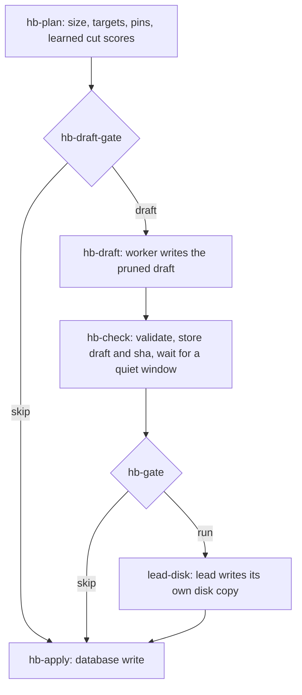

import { Callout } from "fumadocs-ui/components/callout";

The lead runs its `HEARTBEAT.md` checklist on every heartbeat. Agents add items to it all day and rarely remove them, so it grows. Every heartbeat task then pays for the whole file in its prompt. The heartbeat lane of [Dreaming](/docs/guides/dreaming) prunes that checklist once a night.

## How it works



1. **Plan.** `dream-heartbeat` in `plan` mode parses the lead's checklist and measures it against size targets. It lists candidates to cut: expired items, closed items, and items that look stale. It also lists what must stay: lines marked 📌, and items that `dream-learn` pinned because an earlier cut was reverted or added back. The plan carries the learned scores of past cuts, so the draft repeats cuts that held and avoids cuts that did not.
2. **Draft.** The `hb-draft` agent task writes the pruned checklist. It returns the full `draft` and a `removed[]` list in its structured output.
3. **Check.** `hb-check` stores the draft and its sha in KV. It refuses the draft when a pinned line is missing, when the size is off, or when a removed item is not listed in `removed[]`. Then it waits for a quiet window: no lead heartbeat task may be running.
4. **Lead disk.** The lead itself writes the draft to `/workspace/HEARTBEAT.md`. It reads the draft from KV, checks the sha, checks again that no heartbeat task is running, and backs up the old file first. This step exists because the lead's worker syncs `HEARTBEAT.md` from disk back to the database. A database-only write would be overwritten by the old disk copy at the end of the lead's next session.
5. **Apply.** `hb-apply` writes the draft to the database. It refuses when the draft sha does not match what the lead wrote. Before the write, dreaming saves the old checklist as a pre-image.

On a dry run, plan, draft, and check still run, so the report shows the prune that would happen. Nothing is written to the disk or the database.

## Config

| Key | Default | Effect |
|---|---|---|
| `DREAMING_LANE_HEARTBEAT` | `true` | Off: the plan returns `skipReason: "lane off"`, and no draft task runs. |
| `DREAMING_BUDGET_USD` | `25` | When the previous night cost more than 88% of this, the draft is skipped and the report raises an alert. |

Both keys need `DREAMING_ENABLED=true` to have any effect. See [Configuration: Dreaming](/docs/ui/configuration#dreaming).

## Roll back a prune

The checklist lives in two places, so a revert has two steps. Run `dream-heartbeat` in `revert` mode with the run id. It writes nothing and returns the exact steps:

```text
script-run name="dream-heartbeat" scope="global" args={ "mode": "revert", "runId": "<run id>" }
```

1. The lead copies its backup back to `/workspace/HEARTBEAT.md` and checks the sha.
2. The lead runs `dream-heartbeat` in `restore-db` mode with that sha. The database goes back to the pre-image.

Restore the disk first. Otherwise the worker syncs the pruned disk copy back over the restored database.

## Adoption case

Measured on our own swarm, comparing the week before the heartbeat lane went live with the week after:

| Metric | Week before | Week after |
|---|---|---|
| Cost per lead heartbeat-checklist task | $4.19 | $1.59 |
| Lead heartbeat-checklist tasks | 294 | 192 |
| Average prompt per session | 7.2M tokens | 2.4M tokens |

The first cut took the heartbeat from 55,494 to 14,433 tokens.

<Callout type="warn">
An all-clear fast path for heartbeat tasks shipped in the same window ([#1871](https://github.com/desplega-ai/agent-swarm/pull/1871)). Both changes lower the cost of a heartbeat task, so we do not attribute the whole drop to the prune.
</Callout>
