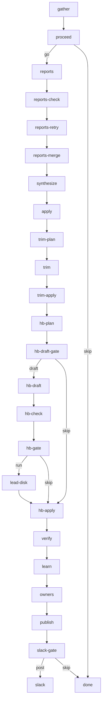

import { Callout } from "fumadocs-ui/components/callout";

Dreaming is a nightly maintenance loop. Each night it asks every active agent to report on its last day of work. The lead then turns those reports into a short list of fixes: memory cleanups, identity edits, profile trims, and a prune of the lead's `HEARTBEAT.md` checklist. Scripts apply the fixes within fixed caps, save the old content first, and re-read every write to confirm it landed.

Every install gets dreaming as a seeded workflow. It ships switched off: until you set `DREAMING_ENABLED=true`, each night runs one read-only step and stops.

## What ships

| Item | Name | Notes |
|---|---|---|
| Workflow | `dreaming` | Enabled. `DREAMING_ENABLED` is the real switch. |
| Schedule | `dreaming-nightly` | `25 3 * * *` UTC. Targets the `dreaming` workflow. |
| Scripts | `dream-gather`, `dream-apply`, `dream-trim`, `dream-heartbeat`, `dream-verify`, `dream-learn`, `dream-owners`, `dream-rollback`, `dream-reports-check` | Seeded, global scope. |
| Settings | **Dreaming** group | Settings → Configuration. See [Configuration: Dreaming](/docs/ui/configuration#dreaming). |

Dreaming stores its state in the `dreaming` KV namespace.

## How a night runs



1. **gather** reads the config, finds the lead and the active agents, and decides the mode: `off`, `dry-run`, or `live`. It runs no agent tasks.
2. **proceed** ends the run when the mode is `off`, there is no lead, or no agent was active. Quiet nights spend no tokens.
3. **reports** asks each active agent for a report on its day. `reports-check` and `reports-retry` chase missing reports once.
4. **synthesize** is a lead task. It reads the merged reports and proposes actions, only for lanes that are on.
5. **apply** runs the identity and memory actions. **trim** shortens agent profiles. The **hb-** steps prune the lead's heartbeat checklist. See [Heartbeat prune](/docs/guides/dreaming-heartbeat-prune).
6. **verify** re-reads every change and compares it with what each step claimed. **learn** scores past cuts: a cut that was reverted or added back gets pinned so dreaming does not cut it again. **owners** sends follow-up tasks for items that need a human or an agent decision.
7. **publish** writes the nightly report. **slack** posts a short summary when a channel is set and the night was live.

## Lanes

Each lane has its own key. A lane that is off creates no agent tasks and writes nothing.

| Key | Default | What it controls |
|---|---|---|
| `DREAMING_ENABLED` | `false` | Master switch. Off: each night stops after `gather`. |
| `DREAMING_LANE_HEARTBEAT` | `true` | Prune of the lead's `HEARTBEAT.md` checklist. |
| `DREAMING_LANE_TRIM` | `true` | Trims of `CLAUDE.md`, `SOUL.md`, and `IDENTITY.md` for each agent. |
| `DREAMING_LANE_IDENTITY` | `true` | Identity edits proposed by `synthesize`. |
| `DREAMING_LANE_MEMORY` | `true` | Memory triage: rename, edit, delete, and store. |

Other keys set the Slack channel, the report target, the agent that runs the worker steps, the budget, and the caps. The full list, with accepted values, is in [Configuration: Dreaming](/docs/ui/configuration#dreaming).

The workflow reads every key at the start of each run, so a saved value applies to the next night without a restart.

## Enable dreaming

1. Set `DREAMING_ENABLED=true` in Settings → Configuration.
2. Optional: set `DREAMING_SLACK_CHANNEL` for a nightly summary, and turn off any lane you do not want.
3. Wait for the next scheduled run, or start one now with `trigger-workflow` on `dreaming`.

The first run after you enable it is a **dry run**. It drafts every change and writes none. Dreaming switches to live writes only after one **green** dry run: `verify` found no writes during the dry run, every claim matched the live state, and its own checks passed. Until then, every night stays a dry run.

To force a dry run later, trigger the workflow with `{ "dryRun": true }`.

<Callout type="info">
The default schedule runs at 03:25 UTC. Move it to about one hour after your deploy window, so a restart does not land in the middle of a run.
</Callout>

## Safety

**Caps.** Each night has hard limits. By default: 6 identity edits in total and 1 per agent, 3 profile trims, 5 new memories, 5 memory edits, and 10 memory deletions. A cap of `0` turns that action off.

**Pre-images.** Before a write, dreaming saves the old content. Memory and identity changes go to a per-run ledger. Profile and heartbeat changes go to a per-run pre-image keyed by agent and field. A trim is refused when the live profile no longer matches its pre-image.

**Verify.** `verify` re-reads each change after the run. It flags writes during a dry run, claims that do not match the live state, and changes no step claimed.

**Rollback.** To undo a night, run `dream-rollback` with the run id:

```text
script-run name="dream-rollback" scope="global" args={ "runId": "<run id>" }
```

Add `"dryRun": true` to preview the result first. Rollback restores profile pre-images first, then undoes the ledger in reverse order. A profile field is restored only when it still holds that run's write. Pass `"overwrite": true` to restore it anyway. To restore only part of a night, pass `agentId` and `field` for profiles, or `actionIds` for ledger items.

The heartbeat has its own revert steps, because the lead also keeps a copy on disk. See [Heartbeat prune: Roll back a prune](/docs/guides/dreaming-heartbeat-prune#roll-back-a-prune).

## Cost

Measured on our own swarm: a mean of **$14.26 per night** over 7 nights, with a mean runtime of **35 minutes**. Your cost depends on how many agents were active and how long their days were.

`DREAMING_BUDGET_USD` (default `25`) is a soft guard. When the previous night cost more than 88% of it, the next night skips the heartbeat draft and the report raises an alert.

## Updates

Dreaming is seeded, so each release can update the workflow, the schedule, and the `dream-*` scripts.

- Your config survives updates. Every value lives in Settings → Configuration, not in the workflow.
- Enabling or disabling the workflow or the schedule does not stop updates. The next release keeps your on or off choice.
- Editing the `dreaming` workflow row stops its updates. From then on, the seeder keeps your version.
- Editing the schedule, for example its cron, stops updates to the schedule only. The workflow keeps updating.

## Overlap with daily-compounding-reflection

The seeded `daily-compounding-reflection` workflow folds the day into memory, skills, and profiles too, without caps, verify, or rollback. When dreaming is on and the `daily-compounding-reflection` schedule is also enabled, the nightly report says so and tells you to disable it. Dreaming does not disable it for you. Running both makes `verify` count the reflection's profile writes as unclaimed changes.
