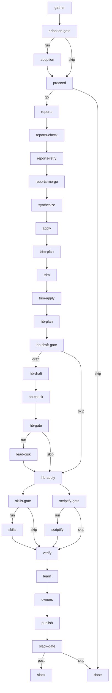

import { Callout } from "fumadocs-ui/components/callout";

Dreaming is a nightly maintenance loop. Each night it asks every active agent to report on its last day of work. The lead then turns those reports into a short list of fixes: memory cleanups, identity edits, profile trims, a prune of the lead's `HEARTBEAT.md` checklist, and new or updated skills and scripts. Scripts apply the fixes within fixed caps, save the old content first, and re-read every write to confirm it landed.

Every install gets dreaming as a seeded workflow. It ships switched off: until you set `DREAMING_ENABLED=true`, each night runs one read-only step and stops.

## What ships

| Item | Name | Notes |
|---|---|---|
| Workflow | `dreaming` | Enabled. `DREAMING_ENABLED` is the real switch. |
| Schedule | `dreaming-nightly` | `25 3 * * *` UTC. Targets the `dreaming` workflow. |
| Scripts | `dream-gather`, `dream-adoption`, `dream-apply`, `dream-trim`, `dream-heartbeat`, `dream-verify`, `dream-learn`, `dream-owners`, `dream-rollback`, `dream-reports-check` | Seeded, global scope. |
| Settings | **Dreaming** group | Settings → Configuration. See [Configuration: Dreaming](/docs/ui/configuration#dreaming). |

Dreaming stores its state in the `dreaming` KV namespace.

## How a night runs



1. **gather** reads the config, finds the lead and the active agents, and decides the mode: `off`, `dry-run`, or `live`. It runs no agent tasks.
2. **adoption** counts the uses of every skill and script dreaming created and retires the unused ones. It runs on quiet nights too, but not when the mode is `off`. See [Adoption gate](#adoption-gate).
3. **proceed** ends the run when the mode is `off`, there is no lead, or no agent was active. Quiet nights spend no tokens.
4. **reports** asks each active agent for a report on its day. `reports-check` and `reports-retry` chase missing reports once.
5. **synthesize** is a lead task. It reads the merged reports and proposes actions, only for lanes that are on.
6. **apply** runs the identity and memory actions. **trim** shortens agent profiles. The **hb-** steps prune the lead's heartbeat checklist. See [Heartbeat prune](/docs/guides/dreaming-heartbeat-prune).
7. **skills** is a lead task that creates and updates skills. **scriptify** is a worker task that builds new scripts at agent scope and proves each one with a positive and a negative control run. Each runs only when its lane is on and `synthesize` approved auto-tier work for it. A propose-tier action is never built; it goes to its owner.
8. **verify** re-reads every change and compares it with what each step claimed. **learn** scores past cuts: a cut that was reverted or added back gets pinned so dreaming does not cut it again. **owners** sends follow-up tasks for items that need a human or an agent decision.
9. **publish** writes the nightly report. **slack** posts a short summary when a channel is set and the night was live.

## Lanes

Each lane has its own key. A lane that is off creates no agent tasks and writes nothing.

| Key | Default | What it controls |
|---|---|---|
| `DREAMING_ENABLED` | `false` | Master switch. Off: each night stops after `gather`. |
| `DREAMING_LANE_HEARTBEAT` | `true` | Prune of the lead's `HEARTBEAT.md` checklist. |
| `DREAMING_LANE_TRIM` | `true` | Trims of `CLAUDE.md`, `SOUL.md`, and `IDENTITY.md` for each agent. |
| `DREAMING_LANE_IDENTITY` | `true` | Identity edits proposed by `synthesize`. |
| `DREAMING_LANE_MEMORY` | `true` | Memory triage: rename, edit, delete, and store. |
| `DREAMING_LANE_SKILLIFY` | `true` | Skill creates and updates by the lead. New skills are adoption-gated. |
| `DREAMING_LANE_SCRIPTIFY` | `true` | Script builds at agent scope. Promotion to global goes to the lead as an owner task. New scripts are adoption-gated. |

Other keys set the Slack channel, the report target, the agent that runs the worker steps, the budget, and the caps. The full list, with accepted values, is in [Configuration: Dreaming](/docs/ui/configuration#dreaming).

The workflow reads every key at the start of each run, so a saved value applies to the next night without a restart.

## Enable dreaming

1. Set `DREAMING_ENABLED=true` in Settings → Configuration.
2. Optional: set `DREAMING_SLACK_CHANNEL` for a nightly summary, and turn off any lane you do not want.
3. Wait for the next scheduled run, or start one now with `trigger-workflow` on `dreaming`.

The first run after you enable it is a **dry run**. It drafts every change and writes none. Dreaming switches to live writes only after one **green** dry run: every lane that was due ran, no step failed, `verify` read everything it needed, found no writes during the dry run and no unclaimed writes, every claim matched the live state, and its own checks passed. Until then, every night stays a dry run.

To force a dry run later, trigger the workflow with `{ "dryRun": true }`.

<Callout type="info">
The default schedule runs at 03:25 UTC. Move it to about one hour after your deploy window, so a restart does not land in the middle of a run.
</Callout>

## Safety

**Caps.** Each night has hard limits. By default: 6 identity edits in total and 1 per agent, 3 profile trims, 5 new memories, 5 memory edits, 10 memory deletions, 1 new skill, 3 skill updates, and 1 new script. A cap of `0` turns that action off. The trim cap goes up to 12.

**Who writes.** The seeded workflow has no creator and the nightly schedule names no agent, so its scripts run as the current lead. That is what lets them edit other agents' profiles. An edited copy of the workflow loses this and runs without a principal, so its writes are refused. Without a lead, the run stops at gather.

**Pre-images.** Before a write, dreaming saves the old content. Memory and identity changes go to a per-run ledger. Profile and heartbeat changes go to a per-run pre-image keyed by agent and field. A trim is refused when the live profile no longer matches its pre-image.

**Verify.** `verify` re-reads each change after the run. It flags writes during a dry run, claims that do not match the live state, and changes no step claimed.

**Rollback.** To undo a night, run `dream-rollback` with the run id:

```text
script-run name="dream-rollback" scope="global" args={ "runId": "<run id>" }
```

Add `"dryRun": true` to preview the result first. Rollback restores profile pre-images first, then undoes the ledger in reverse order. A profile field is restored only when it still holds that run's write. Pass `"overwrite": true` to restore it anyway. To restore only part of a night, pass `agentId` and `field` for profiles, or `actionIds` for ledger items.

The heartbeat has its own revert steps, because the lead also keeps a copy on disk. See [Heartbeat prune: Roll back a prune](/docs/guides/dreaming-heartbeat-prune#roll-back-a-prune).

## Adoption gate

Dreaming may create a skill or a script that nobody needs. The adoption gate retires those, so the catalog does not fill up with unused artifacts.

**Records.** When `verify` confirms that a night created a skill or built a script, it writes one record per artifact: `artifact:skill:<name>` or `artifact:script:<name>` in the `dreaming` KV namespace. A script record also stores the script source, so a deleted script can be restored. Records have no expiry.

**Provenance.** Any agent can write to the `dreaming` KV namespace, so `adoption` and `dream-rollback` act on a record only when the workflow engine's own output backs it. The record's `runId` must be a run of the seeded `dreaming` workflow, and that run's `verify` step must have run the global `dream-verify`. The step's output must also list the record's key as written and confirm the same skill id, or the same script name, scope and contentHash. A record that fails this check is skipped with a reason. It is never retired, marked adopted or restored. An artifact's age counts from no earlier than its run's start.

**Counts.** Each night, `adoption` counts the uses of every `active` record since it was created:

| Artifact | A use is |
|---|---|
| Skill | A `skill_invocations` row for the skill. |
| Script | A `script_runs` row more than one hour after the build, or a completed `swarm-script` step in a workflow run whose node names the script. |

Uses by dreaming's own workflow runs never count, so a skill or script cannot keep itself alive. The one-hour offset skips the control runs that `scriptify` makes right after the build.

**Retirement.** A record with 1 or more uses becomes `adopted`, and the gate stops checking it. A record with 0 uses that is older than `DREAMING_ADOPTION_GATE_DAYS` (default `14`) is retired:

- **Skill:** disabled, not deleted. The gate re-reads the row to confirm it.
- **Script:** deleted, but only when nobody adopted it some other way. A script whose source changed since the build is kept as `adopted-edit`. A script that a workflow definition, a schedule, or another script names is kept as `adopted-ref`. A script promoted to global scope is kept as `adopted-promoted`.

Set `DREAMING_ADOPTION_GATE_DAYS=0` to count uses without retiring anything. The report then shows counts only. On a dry run, the gate lists what it would retire under `wouldRetire` and writes nothing.

The nightly report has an **Adoption** section: what was retired and why, what was adopted, and how many days each pending artifact has left. Before the first artifact exists, it says "no artifacts yet".

<Callout type="warn">
Only recorded invocations count. On Claude Code, a skill that an agent loads by reading its `SKILL.md` file (for example with `cat`) instead of invoking it is not recorded, so a skill that is only ever read that way counts 0 uses and is retired.
</Callout>

**Rollback.** To bring back one retired artifact, run `dream-rollback` in `artifact` mode:

```text
script-run name="dream-rollback" scope="global" args={ "mode": "artifact", "kind": "skill", "name": "<skill name>" }
```

A skill is enabled again. A script is created again at its recorded scope from the stored source, and only when no other script now holds the name. Run it as the script's owner for an agent-scope script. The record becomes `restored`, and the gate does not retire it again. Add `"dryRun": true` to preview.

## Cost

Measured on our own swarm: a mean of **$14.26 per night** over 7 nights, with a mean runtime of **35 minutes**. Your cost depends on how many agents were active and how long their days were.

`DREAMING_BUDGET_USD` (default `25`) is a soft guard. When the previous night cost more than 88% of it, the next night skips the heartbeat draft and the report raises an alert.

## Updates

Dreaming is seeded, so each release can update the workflow, the schedule, and the `dream-*` scripts.

- Your config survives updates. Every value lives in Settings → Configuration, not in the workflow.
- Enabling or disabling the workflow or the schedule does not stop updates. The next release keeps your on or off choice.
- Editing the `dreaming` workflow row stops its updates. From then on, the seeder keeps your version.
- Editing the schedule, for example its cron, stops updates to the schedule only. The workflow keeps updating.

## Overlap with daily-compounding-reflection

The seeded `daily-compounding-reflection` workflow folds the day into memory, skills, and profiles too, without caps, verify, or rollback. When dreaming is on and the `daily-compounding-reflection` schedule is also enabled, the nightly report says so and tells you to disable it. Dreaming does not disable it for you. Running both makes `verify` count the reflection's profile writes as unclaimed changes.
